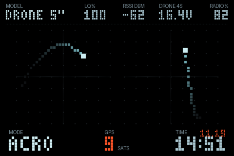
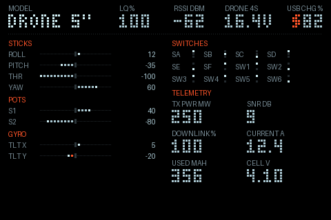
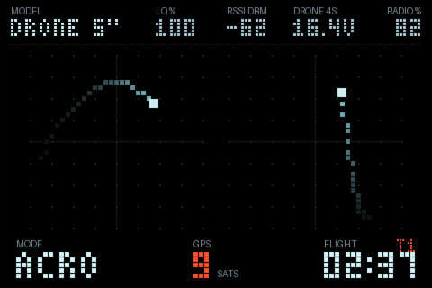
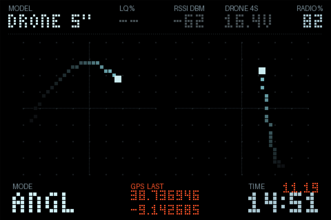
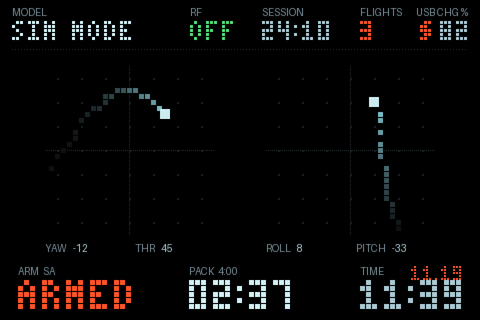
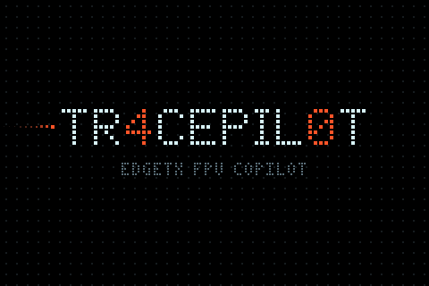

<b>Dot-matrix, TRON-style layout for EdgeTX FPV radios</b> 
RadioMaster TX15 / TX15 Max · widgets · theme · LED ring effects · sounds

TR4CEPIL0T turns the radio screen into a black, dot-matrix cockpit. Its signature is the **fading trail of
both gimbals**, surrounded by the telemetry that matters while flying: link quality, RSSI, drone and radio
battery, flight mode, GPS and timers.

## What's in the pack

- **TPTrails** — page 1: gimbal trails, telemetry top bar, flight mode, GPS (with last known position), time, date and timers.
- **TPInputs** — page 2: sticks, pots, gyro, switches and extra telemetry.
- **TPSim** — a page for a simulator model: RF state, session time, flights, virtual pack timer.
- **Theme** matching the widgets, **boot and shutdown splash** (plus alternative splashes).
- **LED ring effects** for the gimbal rings (10 effects, 9 of them in 10 colours).
- **TRON-style sound effects** for arming, flight modes, battery and link alerts.

## Requirements

- RadioMaster TX15 / TX15 Max (480x320 colour screen) with **EdgeTX 2.10 or newer**.
- Telemetry from an ExpressLRS / Crossfire receiver; Betaflight or INAV for flight mode and GPS.

## Install

1. Download `TR4CEPIL0T_TX15.zip` from the [latest release](../../releases/latest).
2. Back up your SD card.
3. Unzip and copy the folders (`WIDGETS`, `IMAGES`, `SCRIPTS`, `THEMES`, `SOUNDS`) to the **root of the SD card**,
   merging with the existing folders. Restart the radio.

## Set up

1. **Theme:** SYS > Themes > `TR4CEPIL0T`.
2. **Screens:** Model > Screens > add a screen with layout **Full screen (1x1)**, top bar and sliders off,
   and choose the `TPTrails` widget. Add a second screen with `TPInputs`.
3. **Widget options** (colours, stick mode, alerts): long press the widget > Widget settings.
4. **LED effects:** Special Functions > **RGB leds** > choose a script (e.g. `iOrbit`, `iStick`, `ScanC`).
5. **Sounds:** Special Functions > **Play Track**. They are installed in `SOUNDS/pt`; move them to `SOUNDS/en`
   (or your voice-pack folder) if needed.
6. **Alternative splash:** copy an image from `IMAGES/SPLASH/` over `IMAGES/splash.png` (and `shutdown.png`).

## Widgets in detail

Use each widget on its own screen with a **Full screen (1x1)** layout, top bar and sliders off.
The layout also adapts to 320x240 screens (short labels, compact grid).

### Page 1 — Trails (`TPTrails`)
- Top bar (shared with page 2): model name, LQ, RSSI, drone battery (cell count auto-detected), radio battery.
- Middle: trail of both gimbals (24 samples, ~33 per second), faint grid and crosshair.
- Bottom left: flight mode (Betaflight/INAV `FM` sensor, or the radio flight mode).
- Bottom centre, GPS: satellite count while flying; coordinates when disarmed; `GPS LAST` coordinates
  (accent colour) after a crash / telemetry loss; `GPS SAVED` (last position read from the SD card) after a
  restart; `NO GPS` without a GPS sensor. The last fix is saved to `WIDGETS/TPTRAIL/lastgps.txt`
  (every 10 s while it changes, and immediately when telemetry is lost).
- Bottom right: time with the date (small, accent colour). Automatically shows timer 1 while it is counting.
  In widget full screen mode (double tap the widget; exit with a long press on RTN) each tap on the bottom
  right, or ENTER, cycles time -> T1 (flight) -> T2 (pack) -> time.
- Options: `Accent` (colour), `TrailCol` (trail colour), `StickMode` (1-4), `Grid`, `Alerts`.

### Page 2 — Inputs (`TPInputs`)
- Sticks (ROLL, PITCH, THR, YAW), pots, gyro (tilt), switches, extra telemetry
  (TX power, SNR, downlink LQ, current, used mAh, cell voltage).
- Only sources the radio actually has are shown (`getFieldInfo` lookups at start-up).
- Switches start as 2-position and become 3-position once seen in the middle.
- Options: `Accent`, `Alerts`, `Lost`.

### Simulator page (`TPSim`)
For a dedicated "Sim Mode" model (no telemetry or GPS needed).
- Top: model name, RF state (`OFF` green / `ON` blinking red as a warning), session time, flights (arm count), radio battery.
- Middle: gimbal trails with the value of each axis (YAW, THR, ROLL, PITCH in %).
- Bottom: arm state (`ARMED` / `SAFE`), virtual pack timer (counts down only while armed, resets on each new arm,
  turns amber at 30 s and blinks red at 0 with tones), date and time.
- Options: `Accent`, `TrailCol`, `StickMode`, `ArmSw` (switch position; default SA > 0), `PackTime` (minutes).

### Alerts and colours
- LQ < 70 warning, < 50 critical. RSSI < -95 dBm warning, < -105 critical. Cell < 3.5 V warning, < 3.3 V critical.
- Warning = amber; critical = red, blinking when `Alerts` is on.
- With `Lost` / `Alerts`, when telemetry drops the last values stay in grey and the date becomes a blinking `LOST`.
- USB charging indicator: inferred from a steadily rising radio voltage (no Lua API exists for it).

## LED effects (`SCRIPTS/RGBLED`)

Use: Model Settings > Special Functions (or Global Functions) > function **RGB leds**, value = script name.

| Base | Effect |
|---|---|
| iOrbit | white head orbiting with a fading trail, mirrored rings |
| iBrth | slow breathing, peak shifting towards white, rings alternate |
| iSpark | random white sparks over a soft background |
| iDual | top half colour / bottom half white, slowly rotating, mirrored |
| iStat | left ring = LQ, right ring = drone battery, fill from the bottom |
| iStick | white glow in the direction each stick points |
| iScan | light wall sweeping across both rings (light cycle) |
| iLevel | VU meter: throttle ring = throttle, other ring = stick deflection |
| iArm | disarmed orbit / white flash on arming / throttle-driven heartbeat (`ARM_SW` = "sa") |
| iFind | LED finder: one LED per second, ring starts in the main colour |

Colour variants: effect code + colour letter, e.g. `OrbitC`, `StickG`, `ScanU`.
Codes: Orbit, Brth, Spark, Dual, Stat, Stick, Scan, Level, Arm.
Letters: A amber (255,20,0), R red, G green, L lime, Y yellow, B blue, C cyan, P pink, U purple, I lilac.
In `Stat*` variants only the background changes; warnings stay amber.

**TX15 Max ring geometry (confirmed on the radio):** 10 LEDs per gimbal, right ring = 0-9, left ring = 10-19.
LED 0 of each ring faces the centre of the radio; the left ring counts anticlockwise, the right clockwise
(`BASE = { 90, 270 }`, `DIR = { -1, 1 }`, angles clockwise from the top).

## Sounds (`SOUNDS/pt`)

32 kHz, 16-bit, mono PCM, names of up to 6 characters, normalised to -1 dBFS. Play with the **Play Track** function.

`tpon` / `tpoff` (startup / shutdown), `armed`, `disarm`, `fmacro`, `fmangl`, `fmhor`,
`lqlow`, `batlow`, `batcri`, `tellst`, `telok`, `click`.

## Support the project

TR4CEPIL0T is free. If it made your radio a bit cooler and you want to support new features,
you can buy me a coffee on Ko-fi:

Bug reports and ideas are welcome in [Issues](../../issues). Please include your radio model, EdgeTX version
and a photo of the screen.

## Building from source

The packs are generated by `build_all.py` (Python 3 + Pillow). See [docs/DEVELOPMENT.md](docs/DEVELOPMENT.md)
and the [CHANGELOG](CHANGELOG.md).

## Licence and disclaimer

- Code: [GNU GPL v3.0](LICENSE). You may use, modify and share it; modified versions must stay under the
  same licence and keep the credits.
- The **TR4CEPIL0T** name and logo, and the iBass&FPV and Squadding Quads splash images, are not covered by
  the GPL: please don't use them for other projects or products.
- Use at your own risk. Always check your radio, failsafe and model setup before flying.
  Not affiliated with RadioMaster, EdgeTX, ExpressLRS, Betaflight or INAV.
